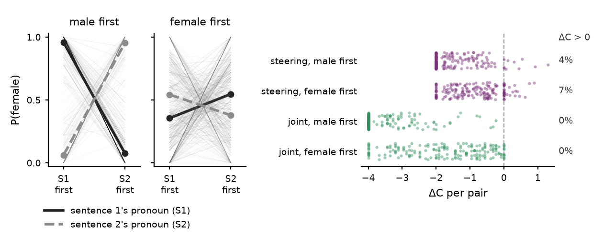
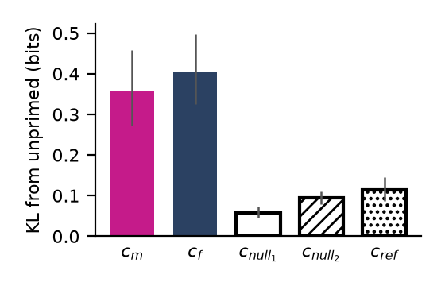
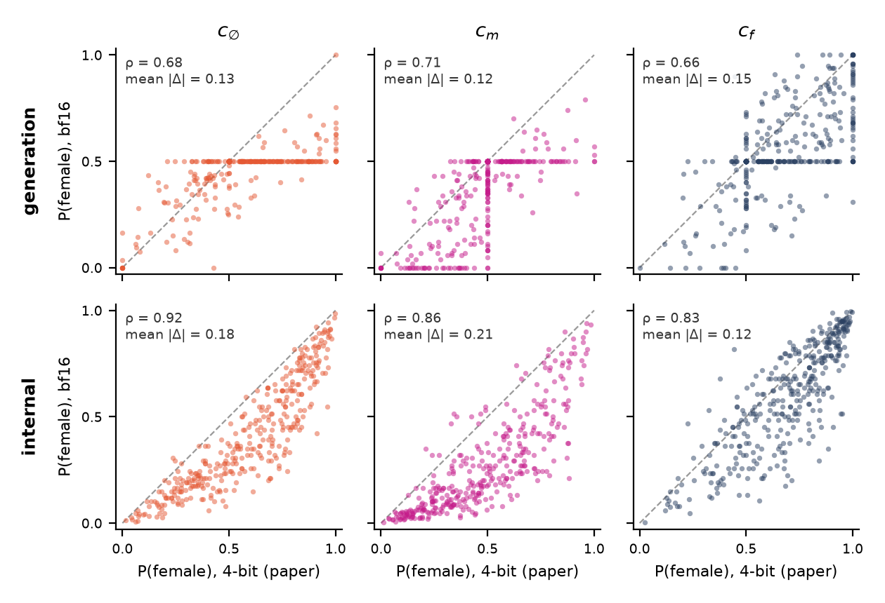

# Sensitivity analyses on Llama-3.1-8B-Instruct (EMNLP revision)

*2026-11-24. Collected locally on an RTX A5000 (`revisions/run_local.sh`); analysis in the "Revision experiments" section of `notebooks/13-sk-paper-figures.ipynb`.*

## Summary

- **Joint measurement: no pair is contextual (0% vs 10.6% under steering).** That is not evidence of non-contextuality. When Llama fills both pronouns itself, it gives the two referents opposite genders (94% of completions) and decides which one gets *she* by the blank's position, not by the referent. The passage order therefore flips each pronoun's distribution, and CbD subtracts that shift, which pins ΔC at or near its floor.
- **Referent-only primes:** naming both referents without a pronoun shifts P(female) about as much as the generic null primes, and about 30% as much as a gendered prime. Referent co-occurrence does not explain the contextual prime's effect.
- **Quantization:** rerunning Llama unquantized (bf16) keeps the prime effect (+0.18 vs +0.19 in mean P(female)) and a similar share of contextual pairs (8.3% vs 10.6%). However, *which* pairs are contextual changes: only 4 are contextual in both runs.

## Data

| Run | Precision | Completions | Compared with |
|---|---|---|---|
| Joint measurement | 4-bit nf4 | 36,200 (181 pairs × 2 passage orders × 2 option orders × 50) | paper's steering data |
| Referent-only null primes | 4-bit nf4 | 36,200 (362 sentences × 2 option orders × 50) | paper's primed and null data |
| Primed, unquantized | bf16 | 144,800 | paper's primed data (4-bit) |
| Null primes, unquantized | bf16 | 108,600 | paper's null data (4-bit) |

The paper ran Llama in bitsandbytes 4-bit nf4. This was verified by recomputing the logits of paper records, which are deterministic: on the records checked, the 4-bit load matches them to within 0.17, while bf16 misses by 1.2–2.7. The joint and referent-only runs therefore use 4-bit, so they compare like with like. The sentinel pair (180) is excluded throughout.

## 1. Joint measurement

**Design.** In the paper's steering design, we fix the pronoun of one sentence (the prime), and the model fills the other. Here the two sentences of a pair form one passage, and the model fills both blanks in a single completion. The two contexts are the passage orders (S1 first, S2 first). Both blanks list their options in the same order (male first or female first, as in the steering analysis). ΔC uses the same CbD rank-2 estimator, in ±1 expectations of the two pronouns V (sentence 1) and W (sentence 2):

ΔC = |⟨VW⟩_S1-first − ⟨VW⟩_S2-first| − |⟨V⟩_S1-first − ⟨V⟩_S2-first| − |⟨W⟩_S1-first − ⟨W⟩_S2-first|

Each term lies in [0, 2]. A pair is contextual only if the first term (how much the *correlation* between the two pronouns changes with order) exceeds the other two (how much each pronoun's own *distribution* changes with order).

**Left panels: P(female) of each sentence's pronoun, in each passage order.** There is one panel per option order. Thin lines are pairs, and thick lines are the mean over pairs. If the model chose each pronoun from its referent, the lines would be flat. Instead they cross: the pronoun follows its position.

| Options listed | Passage | P(f), sentence 1 | P(f), sentence 2 | Referents get different genders |
|---|---|---|---|---|
| male first | S1 first | **0.96** | 0.06 | 98.0% |
| male first | S2 first | 0.08 | **0.95** | 97.0% |
| female first | S1 first | 0.36 | 0.54 | 89.9% |
| female first | S2 first | 0.55 | 0.38 | 92.6% |

With options listed *he, she*, the first blank gets *she* 96% of the time, whichever sentence it belongs to. The second blank gets *he*. With *she, he* listed, the same tendency is weaker: the first blank gets *he* about 63% of the time. In both cases, the first blank tends to take the option listed second. That is the same preference for the second-listed option seen in the steering data (Section 3). Across all completions, the two referents get different genders 94.3% of the time.

**Right panel: ΔC per pair, steering vs joint.** Each dot is one pair, and the right column gives the share with ΔC > 0.

| | male first | female first |
|---|---|---|
| Steering: mean ΔC, % contextual | −1.47, 3.9% | −0.89, 6.7% |
| Joint: mean ΔC, % contextual | −3.52, 0% | −1.75, 0% |
| Joint: share of pairs at the floor (−4) | 61.7% | 7.8% |
| Joint: largest ΔC | −0.24 | 0.00 |

**Where the joint ΔC comes from** (mean over pairs; this reproduces the ΔC means above):

| Options listed | correlation term | − sentence 1 shift | − sentence 2 shift | = ΔC |
|---|---|---|---|---|
| male first | 0.07 | 1.79 | 1.80 | −3.52 |
| female first | 0.20 | 1.00 | 0.95 | −1.75 |

The "opposite genders" rule holds in both orders, so the correlation between the two pronouns barely changes with order: the first term is close to 0. The positional rule moves each pronoun's distribution almost as far as it can go: the other two terms approach their maximum of 2. CbD treats such order-driven shifts as inconsistent connectedness (direct influence of the context) and subtracts them, so ΔC cannot be positive.

The two floors differ: −4 for joint and −2 for steering. In steering we fix the prime, so only the generated pronoun's distribution can shift with order. That is why steering can detect contextuality that the joint design cannot. Item by item, the two designs are unrelated (Spearman ρ of ΔC: 0.25 male first, −0.12 female first).

**Reading for the response letter.** Asked to fill both pronouns, Llama follows a response strategy (assign different genders, chosen by position) rather than resolving each pronoun from its referent. The joint design therefore measures that strategy, and its 0% says nothing either way about the contextuality the steering design reports. The result is not a pipeline artifact: 35,979 of the 36,000 completions for pairs 0–179 fill both blanks with valid pronouns.

## 2. Referent-only null primes

Each sentence is primed with *"The {referent 1} and the {referent 2} were both present."*: the same two referents as the contextual prime, but no pronoun. The figure shows KL from the unprimed baseline, averaged over 360 items, with bootstrap 95% CIs.

| Prime | $c_m$ | $c_f$ | null 1 | null 2 | referents |
|---|---|---|---|---|---|
| KL (bits) | 0.36 [0.27, 0.46] | 0.41 [0.33, 0.50] | 0.06 [0.05, 0.07] | 0.09 [0.08, 0.11] | 0.11 [0.09, 0.15] |

The referent-only prime moves P(female) 30% as much as the gendered primes (Wilcoxon p < 0.001) and no more than the generic null primes (p = 0.82). Mentioning the referents again is not what drives the contextual shift; the pronoun is.

## 3. Quantization: the paper's 4-bit run vs bf16

The figure plots per-item P(female) under the paper's 4-bit run (x) against the bf16 rerun (y). The top row shows generation frequencies, and the bottom row internal (logit) probabilities.

| | 4-bit (paper) | bf16 |
|---|---|---|
| Mean P(f): unprimed / $c_m$ / $c_f$ | 0.56 / 0.48 / 0.66 | 0.46 / 0.37 / 0.55 |
| Prime shift, $c_f$ − $c_m$ | +0.19 | +0.18 |
| % contextual: male first / female first / either | 3.9 / 6.7 / 10.6 | 7.2 / 1.1 / 8.3 |
| KL: $c_m$ / $c_f$ | 0.36 / 0.41 | 0.13 / 0.23 |

- **What survives quantization:** the direction and size of the prime effect, and the share of contextual pairs (8–11%).
- **What changes:** the bf16 model leans less female overall, most clearly in the internal probabilities, where unprimed and $c_m$ points sit below the diagonal. The per-pair contextual verdict agrees on 85.6% of pairs, but only 4 pairs are contextual in both runs (15 only in 4-bit, 11 only in bf16). Rank agreement is ρ = 0.66–0.71 for generation and 0.83–0.92 for internal probabilities.
- **Not a sampling problem:** the stripes at exactly 0.5 in the generation row are positional answers. In the bf16 rerun, all 565 item–prime cells at exactly 0.5 have P(female) = 1 with options listed male first and 0 with female first: Llama answered with whichever option was listed second, so P(female) pooled over the two orders is 0.5. This is the same tendency that drives the joint result.

## Caveats

- **One model only.** The cluster was unavailable, and Gemma-3-12b does not fit unquantized on the local 24 GB GPU (3 s per completion with CPU offload, against 0.2 s for Llama).
- **Smaller rerun.** The bf16 rerun has 50 samples per primed context against the paper's 250, so its generation P(female) is noisier. This partly explains the lower KLs and the verdict churn. Internal probabilities are unaffected.
- **Not bit-identical to the paper.** The 4-bit runs use transformers 5, which keeps bf16 in the unquantized modules where the paper's transformers 4.x used fp16. On the paper records checked, logits differ by up to 0.17.

## Reproduce

`bash revisions/run_local.sh` collects all four runs (24 h here, on a GPU shared with another user; about 17 h on an idle A5000). Rerunning it resumes unfinished collections. Run `notebooks/13-sk-paper-figures.ipynb` top to bottom; the revision section's `revision_models` and `quant_model` are set to Llama. Figures (PDF and PNG) are in `reports/figures/`: `llama8b_joint_vs_steering`, `divergences/llama8b_refnull`, `llama8b_quantization_scatter`.
